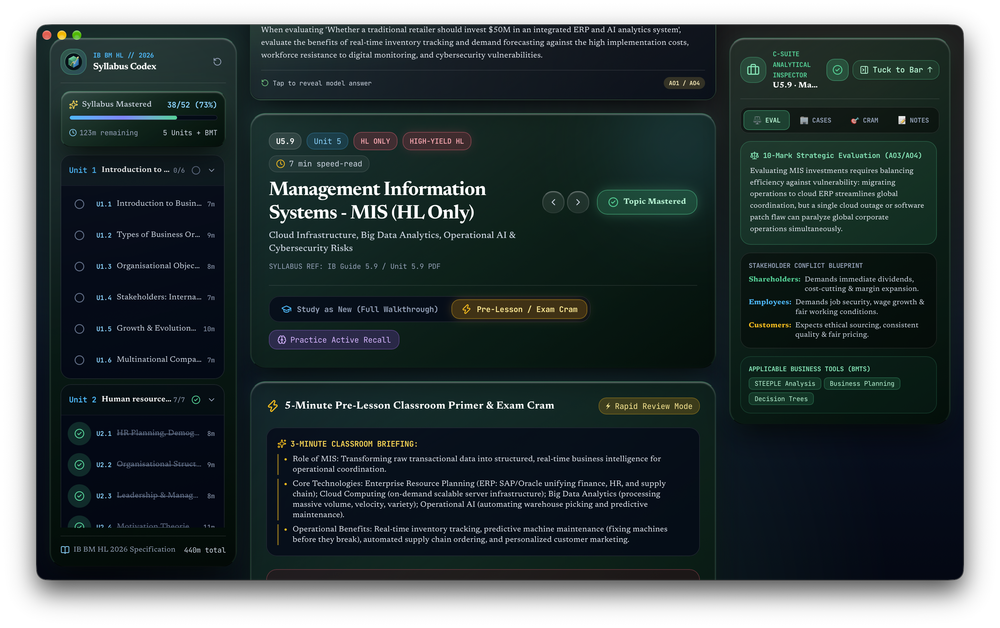
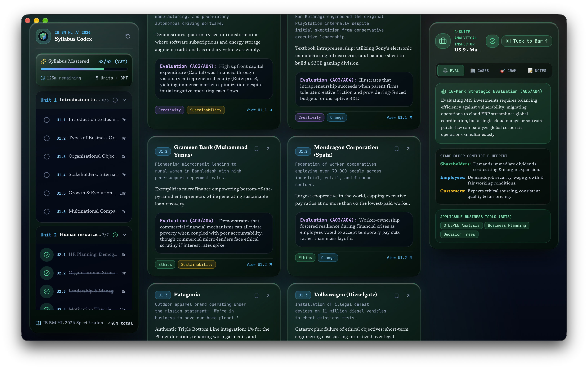
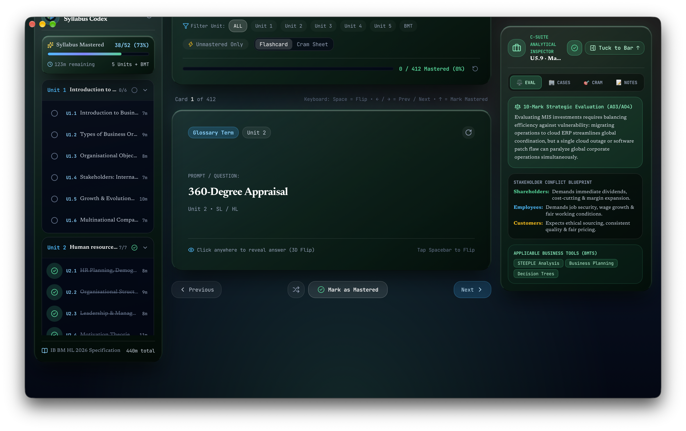
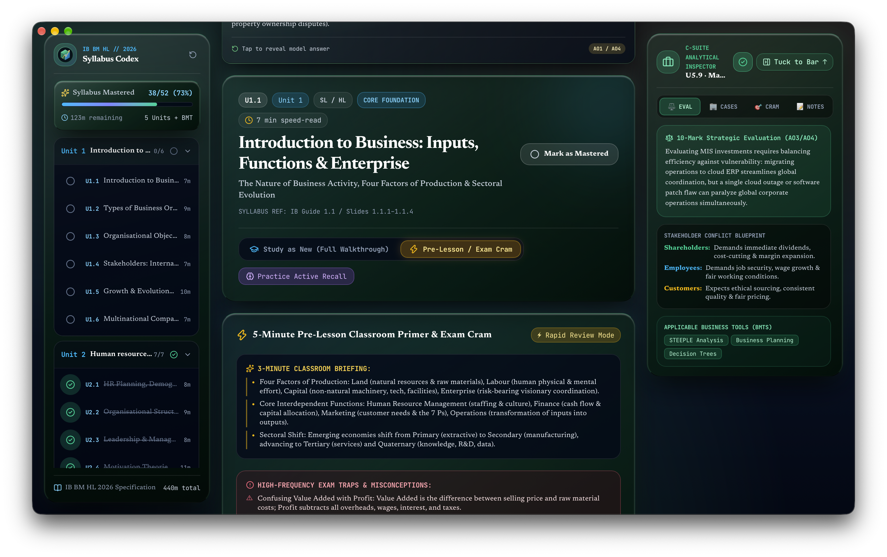
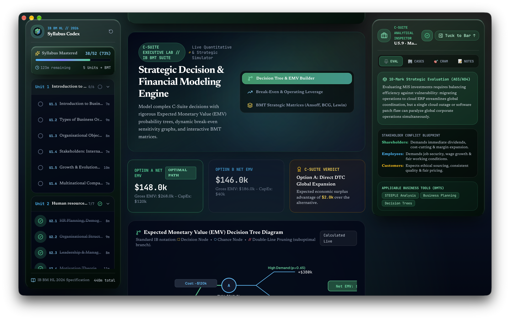

💼 C-Suite Matrix // IB Business Management
The IB Business Management Study Dashboard for macOS

C-Suite Matrix is a native macOS application built for International Baccalaureate (IB) Diploma Business Management students (SL & HL). It combines comprehensive 2024–2026 syllabus analysis, C-Suite frameworks, 15 BMT toolkit models, and real-world multinational case studies with an emerald Liquid Glass bento interface, active revision flashcards, and live desktop widgets.

---

📸 Interface Preview & Navigation

1. The Command Center (Hero Overview)

The primary launchpad provides a high-level view of your syllabus progress and current strategic study target:
* C-Suite Syllabus Mastery Tracker: Tracks completion across all 5 Core Units, 52 syllabus modules, and 15 BMT models in real time, calculating estimated remaining study hours.
* Syllabus Unit Sidebar: Jump straight into any module across Unit 1 (Business Organisation), Unit 2 (HRM), Unit 3 (Finance & Accounts), Unit 4 (Marketing), and Unit 5 (Operations Management).
* Strategic Module Bento: Displays core learning objectives, real-world corporate case anchors (e.g. Tesla, Patagonia, Apple, McDonald's), and C-Suite strategic recommendations.
* Global Spotlight Search: Press `⌘K` to search across all syllabus modules, quantitative formulas, BMT models, and examiner evaluation tips.

---

2. Analytical Hub & Concept / BMT Matrix

Designed specifically for IB Paper 1 (Pre-released Case Study), Paper 2 (Data Response), and Paper 3 (Social Enterprise HL) exam preparation:
* 4 Key Concepts Matrix: Seamlessly analyze any business decision through the lenses of Creativity, Change, Ethics, and Sustainability.
* 15 BMT Quantitative Tools: Interactive breakdowns of Ansoff Matrix, BCG Matrix, Porter's Generic Strategies, SWOT/STEEPLE, Force Field Analysis, Decision Trees, and Critical Path Analysis (HL).
* 10/10 SLAP Evaluative Framework: Detailed guidance for structuring high-scoring evaluation (Stakeholders, Long-term vs. Short-term, Assumptions, Priorities).

---

3. Active Revision Modes

* Continuous Flow Stream: Read uninterrupted syllabus overviews, case studies, and evaluative commentary in a vertical, distraction-free stream.

* Active Recall Flashcards: Test memory retrieval on quantitative formulas, leadership theories (Taylor, Mayo, Herzberg, Pink), and corporate strategies.
* Switch between modes at any time using the Study and Revision toggle in the top bar.

---

4. Formulas & C-Suite Glossary Dossier

* 28 Quantitative Formulas: Instant formulas for Break-Even, ARR, NPV, Profitability Ratios, Liquidity Ratios, and Efficiency Ratios with worked examples.
* Key Terminology Glossary: Over 120 IB examiner definitions for rapid reference.

---

5. Desktop Widgets (macOS WidgetKit)
Keep revision top-of-mind without keeping the full app open:
* Live Study Counter: Displays active study streak, remaining syllabus modules, and current BMT tool on your macOS desktop or Notification Center.
* Multi-Size Liquid Glass Templates: Available in Small, Medium, and Large dossier view.
* Local Offline Sync: Synchronizes instantly across macOS without requiring an account login or cloud database.

---

⌨️ Keyboard Shortcuts

* `⌘ + K`: Open quick Spotlight search for business topics, formulas, and cases
* `⌘ + B`: Toggle sidebar navigation drawer
* `⌘ + I`: Toggle Pro Analytical Inspector
* `⌘ + E`: Launch Timed Exam Sprint mode
* `1`: Switch to Single Module Bento view
* `2`: Switch to Continuous Flow stream view
* `3`: Switch to Active Recall & Cram hub
* `4`: Switch to Concept & BMT Matrix view
* `5`: Switch to Glossary & Formulas dossier

---

🛠️ Technical Highlights

* Modern Web Core: Built using Next.js 16, React 19, and Tailwind CSS.
* Native macOS Shell: Runs inside an Apple AppKit and WKWebView container with smooth 120 FPS animations.
* On-Device Storage: Local state management persists notes, bookmarks, and progress directly on your Mac via Zustand.
* Zero Dependencies: Fully self-contained local build requiring no external cloud databases.

---

🎓 IB CAS Alignment

* Creativity: Conceptualizing, architecting, and engineering a native macOS study dashboard featuring an emerald Liquid Glass design system, interactive BMT financial tools, and macOS desktop widget synchronization.
* Service: Open-sourcing the software to provide secondary school business and economics students globally with a modern, distraction-free exam companion.

---

🛠️ macOS Installation Instructions

Because this is a free, open-source app, macOS Gatekeeper may block it from opening initially because it hasn't been signed by a paid Apple Developer account. 

Here is how to safely install and open it:

1. Download the latest `IBBusinessCodex-macOS-v1.0.dmg` file from the Releases page and double-click to open it.
2. Drag the **IB Business** app into your **Applications** folder.
3. Try to open the app by double-clicking it. You will see a warning that it cannot be opened. Click **Done** or **OK**.
4. Open your Mac's **System Settings** and navigate to **Privacy & Security**.
5. Scroll down to the **Security** section. You will see a message stating the app was blocked to protect your Mac.
6. Click the **Open Anyway** button next to that message.
7. Enter your Mac password or use Touch ID, then click **Open** on the final popup.

*Note: You only need to do this the very first time. Afterward, you can open the app normally from your Launchpad or Spotlight.*
